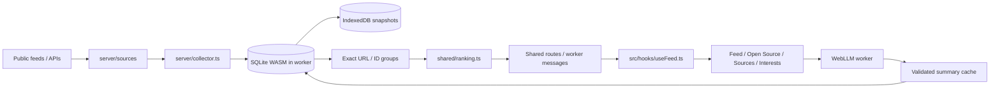

# How Fieldnotes works

The default runtime is entirely in the browser. `src/lib/api.ts` sends requests to a dedicated database worker, which runs the existing collectors, validation, ranking, and routes against SQLite WASM. `src/browser/persistence.ts` atomically saves snapshots to IndexedDB and acknowledges mutations after commit. One Web Lock holds the database open for one tab at a time. `src/browser/restore.ts` validates an imported backup in a separate connection before replacing durable data.

The files under `server/` now include shared application logic: `store.ts` takes a small SQL interface, and `router.ts` registers transport-independent operations. `db.ts` and `app.ts` are the optional Node SQLite/Express adapters. The `#platform` package import selects browser URL checks and an empty environment, or Node DNS checks and server environment variables. No server secrets are injected into browser builds. Both runtimes share the same additive schema migration. WebLLM inference remains in its own browser worker.

`VITE_STORAGE_MODE=server` selects the optional local API. The default browser mode needs only static hosting. GitHub Pages builds the default mode and uses its returned base path for all assets. Database names include the app base path to avoid accidental collisions, but security isolation is by origin, not path. Browser storage is not encrypted at rest by this application; backups are ordinary SQLite files.

## Read the code in this order

1. `shared/types.ts` — the data contracts. A **Source** is one configured feed, an **Item** is one source record, and a **Story** is an exact-identity group with personal state and ranking attached.
2. `server/resources.ts` — the resource catalog shown in the UI. `server/config.ts` contains the six initial feeds and deterministic interest-to-arXiv mapping. A resource preset is not collected until connected.
3. `server/sources/index.ts` — dispatches by resource type. Each sibling file fetches/parses one format. Focus phrases create an arXiv title/abstract query scoped to enabled subjects. There is no general scraper or hidden source-discovery agent. `safe-url.ts` limits custom RSS feeds and redirects to public HTTPS addresses.
4. `server/collector.ts` — schedules collection and preserves prior content on errors. `http.ts` owns timeout, retry, HTTP cache, rate-limit handling and arXiv spacing. A configuration changed mid-fetch is not incorrectly stamped as synced.
5. `server/storage/schema.sql` and `migrate.ts` — the schema and additive upgrade. Existing databases gain metadata, content snapshots, version history, trail evidence and per-revision read tokens without deleting content. Venue, author and publication-type metadata stay separate from summaries.
6. `server/store.ts` — maps rows, upserts immutable source IDs, groups only exact canonical URLs and handles personal state. `stories()` builds groups, then delegates scoring to `shared/ranking.ts`.
7. `shared/ranking.ts`, `briefing.ts` and `pagination.ts` — deterministic retrieval and selection. These can be read and tested without React, SQLite, WebGPU or network access.
8. `src/App.tsx` — page composition, filters, stable ranked paging and selected story. Components live in `src/components`; `hooks/useFeed.ts` owns API state, and `hooks/useLocalAI.ts` owns the optional model lifecycle.

## Follow the research trail code

- `shared/trail.ts`: strict arXiv identity, explicit GitHub URL extraction and a bounded sentence diff. Similar words never become relationship evidence.
- `server/trails/evidence.ts`: converts source metadata into pinned versions and evidence-labeled links; parses the bounded citation response.
- `server/trails/store.ts`: persists shared trail checks and links; manually added links have reversible hiding.
- `server/trails/service.ts`: serial refresh jobs, per-paper request coalescing and cooldown, then independent arXiv/GitHub/Semantic Scholar checks. A failed component preserves other components and prior evidence. `server/index.ts` supplies the same HTTP client as collection so arXiv requests cannot overlap.
- `server/routes/trails.ts`: read, refresh, add, hide/restore endpoints. Manual URLs must be public HTTPS; arbitrary submitted pages are never scraped.
- `src/hooks/useTrail.ts` and `components/ResearchTrail.tsx`: poll while checks are running, render evidence, compare versions, manage known links. Polls cannot overwrite a just-saved link.

`item_history` stores content hashes and first observations; `paper_versions` stores immutable version identities plus supplied title/abstract/comment metadata. `read_token` refers to the exact content hash and arXiv version that was marked read. A revision becomes unread while saved/feedback remain intact. Sources without version metadata cannot downgrade a known newer arXiv item.

`shared/pagination.ts` filters eligible research, orders it by relevance with deterministic ties, validates K, and clamps page boundaries. After moving between paper pages, App retains the ordered IDs for that browsing session so poll-driven score changes do not repeat/skip papers. Search, filters, interests, page size and explicit refresh reset that snapshot.

## A concrete example

Connect `NeurIPS.cc/2026/Conference` in Resources. The OpenReview adapter requests public notes with that exact `content.venueid`. If access succeeds, it keeps paper text, author names, supplied venue, source date and original links. It does not infer acceptance from a title or from an arXiv cross-reference. If the API requires human verification, the source shows that error and its prior successful-sync time stays unchanged.

The collector upserts the record by source ID + external note ID. The database groups exact normalized URLs, adds your read/saved/feedback state, then calls the ranker. React receives data; it never fetches research sources directly.

## What the relevance algorithm actually does

- **Text (0–45):** BM25-style term-frequency saturation, inverse document frequency, length normalization, title boost, phrase boost, and reduced weight for generic words such as “AI” or “model.” Long release notes cannot keep gaining score by repeating keywords.
- **Focus (0–30):** your specific phrases add more weight when present in a title. Optional strict focus requires one phrase.
- **Feedback (−18 to +18):** distinctive terms from explicitly liked/disliked papers plus bounded topic weights. Simply viewing a paper does not train the ranker. Saving alone is not treated as a vote.
- **Freshness (0–12):** exponential decay by publication age; missing dates use discovery time. Later arXiv versions use their explicit update time. This is a ranking fallback, not a fabricated publication date.
- **Context (0 or 3):** a small preference for records with enough source text to assess. This does not certify paper quality.
- **Eligibility:** explicit exclusions and strict focus apply to Papers and New; All remains searchable.
- **Briefing selection:** soft source-repetition and similar-title penalties spread the finite ten-item list. Similarity never merges papers or adds evidence. Reading or dismissing shrinks the selected list instead of refilling it endlessly.

The score is **relevance**, not scientific quality, truth, citation impact or a probability. No popularity or conference-prestige bonus is added. The reader's “Why this matched” exposes the components. Tests cover targeted vs broad matches, keyword-stuffing resistance, exclusions, feedback transfer and variety. These are deterministic behavioral checks, not a human relevance benchmark.

## Where to make a change

The Open Source directory uses `shared/open-source.ts` for project contracts and GitHub username validation, `server/open-source.ts` for paginated public stars and collection persistence, and `server/routes/open-source.ts` for the API. Collection usernames live in SQLite metadata, independently of the 20 reading resources. Project responses use the shared HTTP cache with six-hour freshness, five-minute manual cooldown and stale-data fallback on errors. Malformed successful responses cannot replace a usable collection. `src/components/OpenSource.tsx` provides search, language/topic filters, sorting, local pages and loading further GitHub batches. Following releases uses the existing sources API and collector; browsing never stars a repository or enables collection of all its releases.

| Change                        | File                                                                                       |
| ----------------------------- | ------------------------------------------------------------------------------------------ |
| Add a resource to the picker  | `server/resources.ts`                                                                      |
| Add a collector               | `server/sources/<name>.ts`, dispatch in `index.ts`, type/config validation                 |
| Change initial feeds          | `server/config.ts` (existing settings persist in SQLite)                                   |
| Tune relevance                | `shared/ranking.ts` + `test/ranking.test.ts`                                               |
| Tune the finite shortlist     | `shared/briefing.ts`                                                                       |
| Change trail collection       | `server/trails/` + `shared/trail.ts`                                                       |
| Change ranked paging          | `shared/pagination.ts`, `src/components/Pagination.tsx`                                    |
| Change the reader             | `src/components/StoryReader.tsx`                                                           |
| Change source controls        | `src/components/ResourceLibrary.tsx`                                                       |
| Change Reddit collection      | `server/sources/reddit.ts`, `shared/reddit.ts`, `test/reddit.test.ts`                        |
| Change models or prompt       | `src/local-ai.ts`, `shared/summary.ts` (bump prompt version)                               |
| Add authenticated users later | Resolve profile ID in routes; scope personal tables; collect the union of member interests |

## Boundaries worth keeping

Reddit is a distinct `SourceKind` with a normalized `config.subreddit` and optional `sort` (`new`, `hot`, `top`). The source catalog is opt-in; `/api/resources` adds transport/retirement notices from server configuration without exposing tokens. `collectReddit` uses a server-only approved bearer token when configured, otherwise the bounded public Atom feed until its November 13, 2026 retirement. Rejected API tokens never trigger a fallback. HTTP requests with authorization cannot follow redirects, and Reddit rate-limit reset headers are interpreted as seconds from now. Discussion IDs (`t3_<id>`) and canonical discussion URLs stay consistent between transports and distinct from linked research. Topic providers search collected Reddit text, rather than implying upstream Reddit search. The source and local summary show post-excerpt scope; comments are not ingested.

The feed opens on Latest so every connected content type is visible. Papers retains stable ranked paging. Search stays within the current view or followed topic; discovery is a separately labeled mode. `intuitive.css` styles the feed controls and empty states, and `components/sources.css` scopes the source setup controls. Source search includes configured feed labels and configuration, and validation errors remain beside their card/form.

`server/index.ts` only starts/stops the process. `server/app.ts` handles the common HTTP boundary; routes are grouped by responsibility. `server/adapters.ts` is a small compatibility re-export for existing tests, not another adapter implementation.

Shared SQLite tables hold sources, items, exact groups, paper versions, trail evidence and summaries. Profile interests, votes and reading state are personal. WebLLM runs only in `src/model.worker.ts`; model files download after explicit consent. Local AI is preferred by default; the hook checks capability and IndexedDB before automatically resuming a cached model. It automatically summarizes only the selected uncached source; the New list can process a maximum of ten sequentially. A cross-tab Web Lock prevents duplicate GPU loads. Disabling persists, cancellation releases the worker and lock, and failures preserve source reading. JSON validation does not establish factual correctness. The 0.5B model failed a factual spot check, so 1.5B remains the recommended default.

## What to improve next

Use your actual judgments to evaluate relevance: keep a small set of research questions and papers you consider relevant, then compare the top ten before changing weights. Tests here establish behavior, not precision or recall on a labeled research benchmark.

The evidence-linked trail is implemented; full-paper comparisons and exhaustive citation discovery are outside this version. Browser-local embeddings could add paraphrase matching later; they should supplement lexical retrieval and retain visible source evidence. A larger summarizer alone does not solve discovery.

## Saved topics and summary depth

`server/topics.ts` provides all-subject arXiv discovery and local matching over configured providers. `server/routes/topics.ts` exposes provider capabilities, search previews, follow, rename, pause/resume and remove. `followed_topics` stores personal queries/providers and per-provider status; `topic_items` links exact story groups. No source is created for each query. Existing arXiv items are reused; their displayed provenance is arXiv, independent of the category feed that first collected them. The collector invokes topic refresh after resource collection, and a newly followed topic starts immediately with the shared HTTP client and arXiv queue. A pause/removal made during a request wins over its response. Unfollow cascades only the topic membership, preserving content and personal state. Legacy combined focus searches migrate once, retaining old content and linking matching records.

`SearchAndFollow.tsx` separates Library and Discover with a shared search bar, exposes provider capabilities and preview provenance, and ignores stale search responses. Topic chips read membership rather than applying the global relevance gate; unrelated fields remain visible in their own feeds. `FollowedTopics.tsx` holds management and provider status in Interests.

`shared/summary.ts` owns depth definitions, output budgets, the 4,800-character input limit, and the exact final model input message. `summary_results` keys the full input message, depth, model, prompt version and interests. The old summary table is retained but cannot satisfy the new prompt/depth cache. PUT rejects changed source content or interests. The slider commits on pointer release or keyboard release, stays disabled during generation, and exposes cancellation. Abstract-only scope is visible before and after generation. Detailed prompts identify gaps rather than inventing full-paper detail. All inference stays in the local WebLLM worker.
